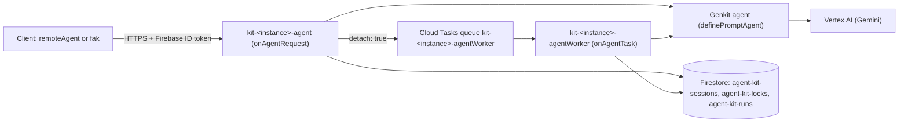
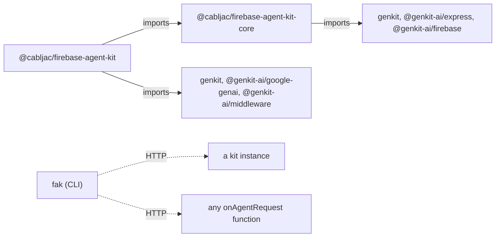
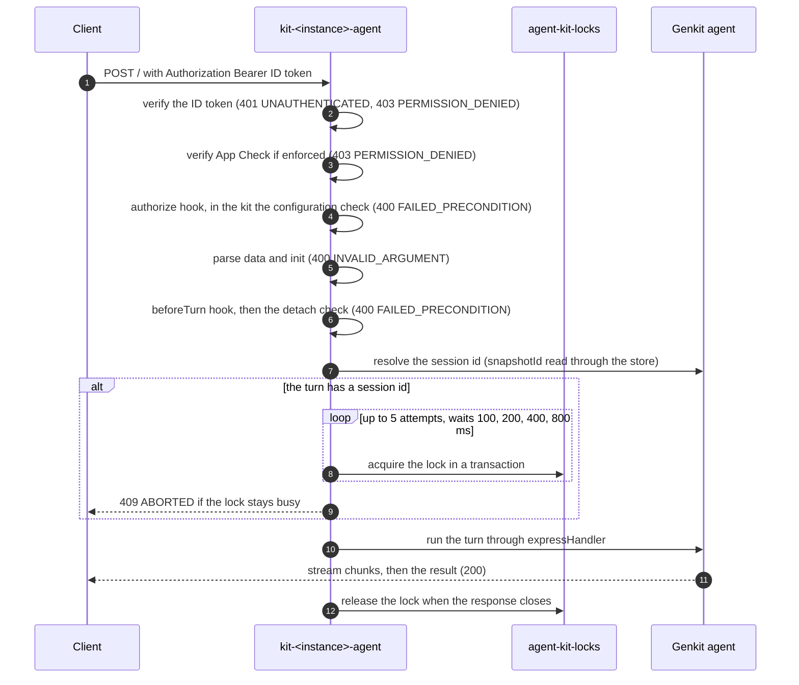
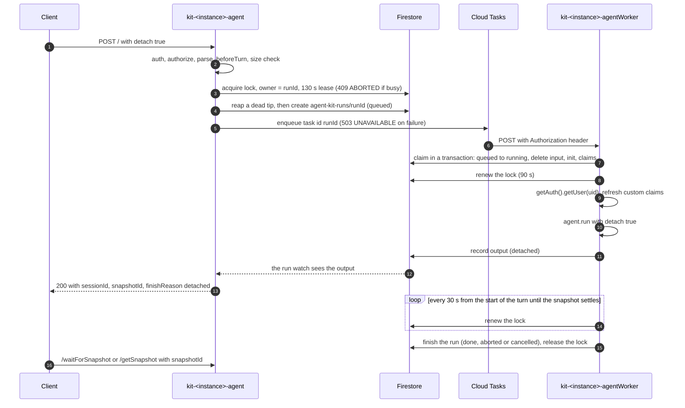
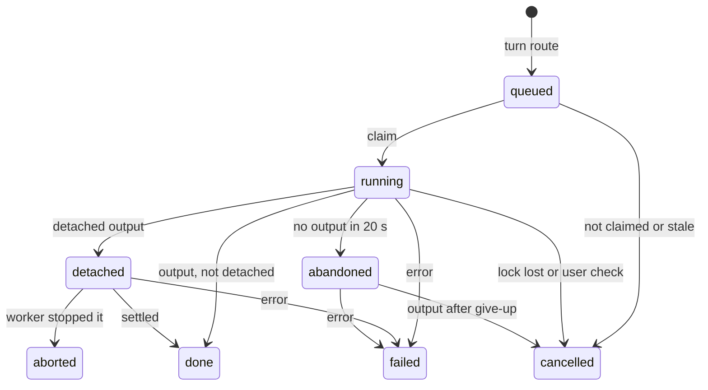

# Architecture

This document explains how the system works: the request path, session isolation, the turn lock and detached turns. It does not list the API or the params. For those, see the package READMEs: [core](packages/core/README.md), [kit](packages/agent-kit/README.md) and [CLI](packages/cli/README.md).

## Overview

The project serves one Genkit 1.44 beta agent per kit instance from Firebase Cloud Functions, for many signed-in users. An HTTPS function runs each turn of the agent and writes the session to Firestore. A detached turn runs in a second function that Cloud Tasks calls.

`expressHandler(agent)` from `@genkit-ai/express` serves only the turn route. It takes a context provider, but it does not key sessions by user or serialize turns. This project adds auth on every route (turn, snapshot and abort), sessions keyed by the user, one turn at a time per session, and detached turns through Cloud Tasks.



## Package layers

| Package                                                                  | Owns                                                                                                                                                                                        |
| ------------------------------------------------------------------------ | ------------------------------------------------------------------------------------------------------------------------------------------------------------------------------------------- |
| `@cabljac/firebase-agent-kit-core` ([packages/core](packages/core))      | `onAgentRequest` (the HTTPS routes), `createUserScopedStore`, `FirestoreTurnLock`, `defineDetachedTurns` and `onAgentTask` (the worker). It works with any Genkit agent.                    |
| `@cabljac/firebase-agent-kit` ([packages/agent-kit](packages/agent-kit)) | The Function Kit. It defines the params, the prompt agent of the instance, the `ai` object with authed tools, the `skills`, `retry` and `fallback` middleware, and the configuration check. |
| `@cabljac/firebase-agent-kit-cli` ([packages/cli](packages/cli))         | `fak`, a terminal client. It finds the function URL, signs in, and talks to the routes with the stock `remoteAgent`.                                                                        |



The kit calls the core library and adds no request logic of its own. Its configuration check runs as the `authorize` hook of `onAgentRequest` (`packages/agent-kit/src/index.ts`). `fak` has no code dependency on the other two packages. It needs only the routes that `remoteAgent` uses, so it works with a kit instance or with any `onAgentRequest` function.

## A turn

`createAgentApp` in `packages/core/src/handler.ts` builds an express app with four `POST` routes: `/` (the turn), `/getSnapshot`, `/waitForSnapshot` and `/abort`. Every route runs the same checks first. Only the turn route parses a turn, takes the lock and runs the agent.



The steps in order:

1. **Auth and App Check.** `firebaseContext` from `@genkit-ai/firebase/context` verifies the ID token. A missing token gets 401 `UNAUTHENTICATED`. An invalid token gets 403 `PERMISSION_DENIED`. With `enforceAppCheck` on, a missing or invalid App Check token gets 403. A present but invalid `X-Firebase-AppCheck` header gets 403 even when enforcement is off. The context must hold a uid, the decoded claims and the raw token (`isRequestContext` in `packages/core/src/guards.ts`).
2. **`authorize`.** The hook runs on every route. A `GenkitError` from a hook keeps its status. Any other error answers 500 `INTERNAL` (`sendError` in `packages/core/src/guards.ts`). In the kit, this hook is the configuration check (see [The configuration check](#the-configuration-check)).
3. **Parse.** The turn route parses `data` with `AgentInputSchema` and `init` with `AgentInitSchema`. A bad body gets 400 `INVALID_ARGUMENT`.
4. **`beforeTurn` and the detach check.** `beforeTurn` gets the parsed input. Then a turn with `detach: true` goes to the detached path (see [Detached turns](#detached-turns)), or gets 400 `FAILED_PRECONDITION` when detached turns are off or not configured.
5. **Session id.** `resolveSessionId` follows Genkit's precedence: a non-empty `snapshotId` wins over `sessionId`. It reads a `snapshotId` through the agent's own store, so it sees only the caller's snapshots. A turn with no ids, or with a snapshot id the caller cannot see, gives no session id.
6. **Lock.** With a session id, the route takes the turn lock (see [The turn lock](#the-turn-lock)). It tries 5 times, with waits of 100, 200, 400 and 800 ms. A lock that stays busy gives 409 `ABORTED`. A turn with no session id takes no lock: Genkit gives it a new session id. When the agent has a `detach` config, the route then runs the reaper on the session (see [Crash recovery](#crash-recovery-the-reaper)).
7. **The turn.** `expressHandler` runs the agent with the context from step 1. It streams when the client sends `Accept: text/event-stream` or `?stream=true`. Genkit reports most turn failures in the result, as HTTP 200 with `finishReason: 'failed'`. After the first byte is sent, an error can only end the response. An error that escapes the agent action, such as an `AgentInitError` or a failed snapshot write, gets 500 `INTERNAL`. On a streaming turn it gets an `error:` frame with `INTERNAL` (see [Upstream couplings](#upstream-couplings)).
8. **Release.** The route releases the lease when the response closes, at the end of the turn or on a client disconnect. On a disconnect, a non-streaming turn is aborted, because `expressHandler` listens for `close` on the response. A streaming turn is not aborted. `expressHandler` listens for `close` on the request, and Node emits that event once `express.json()` has read the body, before the listener is added. So a streaming turn keeps running after a disconnect, without the lock (see [The turn lock](#the-turn-lock)).

The snapshot and abort routes do not go through `expressHandler`. `runAction` in `packages/core/src/handler.ts` runs the Genkit action directly, so a 4xx `GenkitError` keeps its status. A 5xx error becomes 500 `INTERNAL` (see [Upstream couplings](#upstream-couplings)).

## Sessions and isolation

`createUserScopedStore` (`packages/core/src/store.ts`) wraps Genkit's `FirestoreSessionStore`. It gives the store a `snapshotPathPrefix` that is the user key of the caller. `userKey` in `packages/core/src/keys.ts` computes it:

```text
userKey(uid, scope) = sha256 hex of JSON.stringify([scope ?? null, uid])
```

The kit passes its instance id as the scope. Each (scope, uid) pair gives a distinct JSON array, so it gives a distinct key. A uid with special characters cannot make two pairs collide.

The store writes three collections. `<user key>` is the prefix above:

| Collection                    | Document path                                                 | Holds                                             |
| ----------------------------- | ------------------------------------------------------------- | ------------------------------------------------- |
| `agent-kit-sessions`          | `agent-kit-sessions/<user key>/snapshots/<snapshotId>`        | One document per snapshot.                        |
| `agent-kit-sessions-pointers` | `agent-kit-sessions-pointers/<user key>/pointers/<sessionId>` | One pointer per session, to its latest snapshot.  |
| `agent-kit-sessions-shards`   | `agent-kit-sessions-shards/<user key>/shards/...`             | The sharded checkpoints with the message history. |

The `collection` option renames them to `<collection>`, `<collection>-pointers` and `<collection>-shards`.

**Why one user cannot reach another user's session.** Every store call computes the prefix from `context.auth.uid`, and a call with no uid fails with `UNAUTHENTICATED`. The uid comes from the verified ID token, not from the request body. A snapshot id or session id from the client only names a document under the caller's own prefix. The same rule holds across kit instances, because the instance id is part of the key.

What a client sees when it sends an id that is not its own:

| Request                                                 | Result                                                                                           |
| ------------------------------------------------------- | ------------------------------------------------------------------------------------------------ |
| `/getSnapshot` or `/waitForSnapshot`, another user's id | 404 `NOT_FOUND`, the same answer as for an id that does not exist.                               |
| `/abort`, another user's snapshot id                    | 200 with no `status`. Nothing changes. An unknown id gives the same answer.                      |
| Turn with another user's `snapshotId`                   | 200 with `finishReason: 'failed'` and a `NOT_FOUND` error. A detached turn gets 404 `NOT_FOUND`. |
| Turn with another user's `sessionId`                    | A new session with that id, under the caller's own prefix.                                       |

The library cannot check that an agent uses this store. It reads sessions through the agent's own store. The Firestore rules must also deny all client access to these collections (see [Security](packages/core/README.md#security)).

## The turn lock

`FirestoreTurnLock` (`packages/core/src/lock.ts`) keeps one document per session in `agent-kit-locks`. The document id is the sha256 hex of the lock key. The document holds `owner` and `expiresAt` (epoch milliseconds).

**The key.** `lockKey(uid, sessionId)` in `packages/core/src/keys.ts` is `${userKey(uid)}:${sessionId}`. The user key here has no scope. So a turn on one kit instance also blocks a concurrent turn of the same user with the same session id on another instance. This is on purpose: a lock that covers more than one agent is safe, while a separate lock scope could only weaken locking. Hashing the uid also prevents a collision between uids that contain a colon.

**Lease length.**

| Holder                    | Lease                                              | Renewed                   |
| ------------------------- | -------------------------------------------------- | ------------------------- |
| HTTP turn                 | Function timeout + 30 s (timeout defaults to 60 s) | No                        |
| Turn route, detached turn | 130 s (20 s claim wait + 20 s output wait + 90 s)  | No, the worker takes over |
| Worker                    | 90 s                                               | Every 30 s                |

The HTTP lease covers the longest time Cloud Functions lets the turn run. The timeout is the deployed value from `fn.__endpoint.timeoutSeconds` (`onAgentRequest` in `packages/core/src/handler.ts`).

**Operations.** Each operation is a Firestore transaction:

- `acquire` writes `{ owner, expiresAt: now + leaseMs }` when no document exists or `expiresAt` is in the past. Otherwise it returns `null`. An HTTP turn uses a random UUID as the owner. A detached turn uses the run id.
- `renew` sets a new `expiresAt` only when `owner` matches. It does not check `expiresAt`, so a lapsed lease that nobody took is renewed.
- `release` deletes the document only when `owner` matches.

`expiresAt` uses the clock of the function instance (`Date.now()`), not the Firestore server time.

**When a holder dies.** Nothing deletes the document. The lease lapses, and the next `acquire` takes it over. An HTTP turn cannot outlive the function timeout, so its lease outlasts the turn by 30 s. A worker lease lapses at most 90 s after the last renewal.

**Fencing.** The lock is advisory. Session writes do not carry the lock owner, so a holder that lost its lease can still write. The worker fences itself: when a renewal finds another owner, it aborts its turn. It can still write until that renewal, at most 30 s later, plus the time the abort takes. The HTTP route has a larger gap. It releases its lease when the client disconnects, but the turn can still run. A non-streaming turn is aborted at once, but Cloud Functions throttles CPU after the response, so its last writes can come late. A streaming turn is not aborted and runs to its end. A new turn on the same session can run in that time. Both turns then write snapshots of the session. The writes stay under the user's own prefix, so no other user's data is at risk.

## Detached turns

A detached turn runs in the background. Cloud Functions throttles CPU after the HTTP response, so the turn cannot run in the HTTP function. The turn route hands it to `kit-<instance>-agentWorker` through Cloud Tasks. The code is in `packages/core/src/detach.ts` (the turn route), `packages/core/src/worker.ts` (the worker) and `packages/core/src/runs.ts` (the run documents).



**The turn route** (`startDetachedTurn` in `packages/core/src/detach.ts`):

1. It runs the same checks as an HTTP turn. A new session gets a random session id first, so every detached turn takes the lock. A `snapshotId` the caller cannot see gets 404 `NOT_FOUND`.
2. It rejects a run document that would pass Firestore's 1 MiB limit with 400 `INVALID_ARGUMENT`, before the lock.
3. It takes the lock with the run id as the owner, then runs the reaper on the session.
4. It creates `agent-kit-runs/<runId>` with `status: 'queued'`, `uid`, `instanceId`, `lockKey`, `input`, `init`, the decoded ID token claims, `createdAt` and `expireAt` (7 days later). The raw ID token is not stored.
5. It enqueues a task named after the run, with the run id as its only payload and a dispatch deadline equal to the worker timeout.
6. It watches the run document for 20 s until the status leaves `queued`, then for 20 s more until the run has an output or a final status. Then it writes the worker's output as the turn result, as one SSE frame or a `{ result }` body.

**The task token.** firebase-admin enqueues the task. Inside a kit, it reads `FIREBASE_KIT_INSTANCE_ID`, targets the queue `kit-<instance>-agentWorker`, and, when the credential is the Compute Engine default credential (the deployed case), puts an ID token of the runtime service account in the `Authorization` header. Cloud Tasks does not check `iam.serviceAccounts.actAs` for that header. Outside a kit, or with any other credential, firebase-admin falls back to an OIDC token, which needs `actAs` on the service account.

**The worker** (`runDetachedTask` in `packages/core/src/worker.ts`):

1. It refuses the task when detached turns are off. The task queue never retries (`maxAttempts: 1`).
2. It claims the run in a transaction. The claim refuses a missing run, a run that is not `queued` (a second delivery), and a run of another instance. A run created more than 30 s earlier is stale: no turn route waits for it any more. The claim cancels it and the worker releases the lock. A good claim moves the run to `running` and deletes `input`, `init` and `claims` from the document in the same transaction.
3. It renews the lock with the run id as the owner. If the renewal fails, the run no longer owns the lock, and the run ends `cancelled`.
4. It calls `getAuth().getUser(uid)`. A deleted user, a disabled user, or tokens revoked after the token's `auth_time` end the run `cancelled`. The turn route then answers 401 `UNAUTHENTICATED` or 403 `PERMISSION_DENIED`.
5. It builds the context `{ auth: { uid, token } }`. The token holds the original standard claims and the current custom claims. It has no raw token.
6. It runs the turn with `detach: true` and records the output. Genkit returns at once with `finishReason: 'detached'` and a snapshot id, and the turn continues in the worker.
7. It waits until the snapshot settles, finishes the run, and releases the lock.

**Fencing in the worker.** While the turn runs, the worker renews the lock every 30 s. It aborts the turn through `agent.abort` when:

- a renewal finds that it no longer owns the lock;
- no renewal succeeded for 50 s, before the 90 s lease can lapse;
- the worker timeout is 20 s away (it also stops renewing then);
- the turn route abandoned the run;
- waiting for the snapshot fails.

**Following the turn.** The client gets the session id and the snapshot id. It follows the turn with `/waitForSnapshot` or `/getSnapshot`, and can stop it with `/abort`. When the client goes away after the claim, the turn keeps running. To reattach, a client reads the session's latest snapshot with `/getSnapshot` and `sessionId`. If its status is `pending` or `aborting`, the client waits on its snapshot id. `fak` does this on `/resume` (`loadSession` in `packages/cli/src/chat.ts`).

### Run statuses

The statuses are the `RunStatus` type in `packages/core/src/runs.ts`. `create` and `finish` are single writes. The other moves are Firestore transactions.



Where each move happens:

| Move                                                   | Code                                                                                                     |
| ------------------------------------------------------ | -------------------------------------------------------------------------------------------------------- |
| to `queued`                                            | `FirestoreRunStore.create`, from `startDetachedTurn`                                                     |
| `queued` to `cancelled` (turn route)                   | `cancelIfQueued`, when the enqueue fails, no claim comes in 20 s, or the client closes                   |
| `queued` to `cancelled` (worker)                       | `claim`, for a run created more than 30 s earlier                                                        |
| `queued` to `running`                                  | `claim`                                                                                                  |
| `running` to `abandoned`                               | `abandonIfNoOutput`, when the 20 s output wait ends with no output. The route answers 503 `UNAVAILABLE`. |
| to `detached` or `done`                                | `recordOutput`. It does not overwrite `abandoned`.                                                       |
| `running`, `detached` or `abandoned` to a final status | `finish`, from `runDetachedTask`                                                                         |

A crashed worker leaves its run at `running` or `detached`. Nothing rewrites it. The TTL policy on `expireAt` deletes it once the 7 days pass.

### Crash recovery: the reaper

`reapDeadTip` in `packages/core/src/reaper.ts` settles the session snapshot of a dead detached turn. It does not touch the run document.

- **When it runs.** On every turn of a session, after the turn takes the lock, when the agent has a `detach` config. This covers HTTP turns and detached turns.
- **What it checks.** The session's latest snapshot has the stored status `pending` or `aborting`, and its `heartbeatAt` (else `updatedAt`, else `createdAt`) is more than 60 s old.
- **What it writes.** It rewrites that snapshot as `aborted`, with `finishReason: 'aborted'`, an `ABORTED` error, the state of its parent snapshot (or an empty state), and no heartbeat. Genkit's finalize never overwrites an `aborted` snapshot, and a new turn resumes from it like any aborted turn.

The lock makes this safe. A live worker renews the lock, so no other turn can take it and run the reaper. A dead worker's lease lapses at most 90 s after its last renewal. The worker renews every 30 s, so by then its last heartbeat is normally more than 60 s old.

## What a deploy creates

For each kit instance, `firebase deploy` creates:

| Resource            | Name                                                                                  | Source                                        |
| ------------------- | ------------------------------------------------------------------------------------- | --------------------------------------------- |
| HTTPS function      | `kit-<instance>-agent`                                                                | `export const agent = onAgentRequest(...)`    |
| Task queue function | `kit-<instance>-agentWorker`, with `maxAttempts: 1` and `maxConcurrentDispatches: 10` | `export const agentWorker = onAgentTask(...)` |
| Cloud Tasks queue   | `kit-<instance>-agentWorker`, in the function region                                  | the task queue function                       |

The worker and its queue exist even with `DETACHED_TURNS=false`. Params cannot change which functions a kit exports. The worker then refuses every task.

The first deploy of the kit also creates a managed `firebase-fn-*` service account and attaches it to every instance. The `requiresRole` and `requiresAPI` calls in `packages/agent-kit/src/index.ts` give it five project roles and enable three APIs. See [Required IAM](packages/agent-kit/README.md#required-iam) for the list and the reason for each.

The Firestore collections appear on first write: `agent-kit-sessions`, `agent-kit-sessions-pointers`, `agent-kit-sessions-shards`, `agent-kit-locks` and `agent-kit-runs`. All instances share them. The deploy sets no TTL policy. Before you turn on detached turns, set one on `expireAt` in `agent-kit-runs` (see [Deploy](packages/agent-kit/README.md#deploy)). The session and lock collections have no TTL field.

## The configuration check

`createPromptCheck` in `packages/agent-kit/src/lib.ts` builds the check. The kit passes it as the `authorize` hook, so it runs only in `kit-<instance>-agent`, not in the worker.

**When it runs.**

- **At cold start.** `checkAtColdStart` runs it once in the background and logs any problem. It does not block requests. It does not run during deploy discovery (`FUNCTIONS_CONTROL_API=true`).
- **On each request, until it passes.** It runs on every route, after auth and App Check. A failure logs the details and answers 400 `FAILED_PRECONDITION`. The message holds the details only in the Functions emulator. After one pass, the instance caches the result and skips the check.

**What it checks.** The raw values of the boolean params, the detached turn timeouts when `DETACHED_TURNS=true`, the prompt file, its `tools:` and `use:` lists, and the skills. See [Configuration checks](packages/agent-kit/README.md#configuration-checks) for the full list.

## Upstream couplings

The code works around two upstream problems and reads some upstream internals. [Upstream workarounds](packages/core/README.md#upstream-workarounds) has the details. In short:

- The snapshot and abort routes run the Genkit actions directly, not through `expressHandler`, so a 4xx `GenkitError` keeps its status.
- The kit patches `registry.dotprompt.renderMetadata` so that bare names in `use:` reach generate calls.
- The code reads the internals `__action`, `__endpoint`, some registry keys, and builds `ai` with `Object.create(instance)`.
